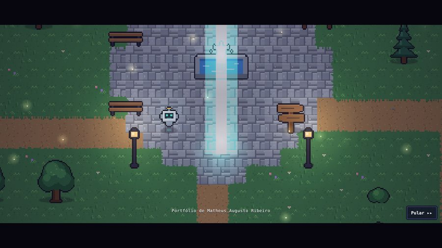
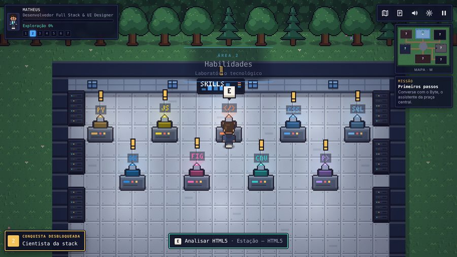
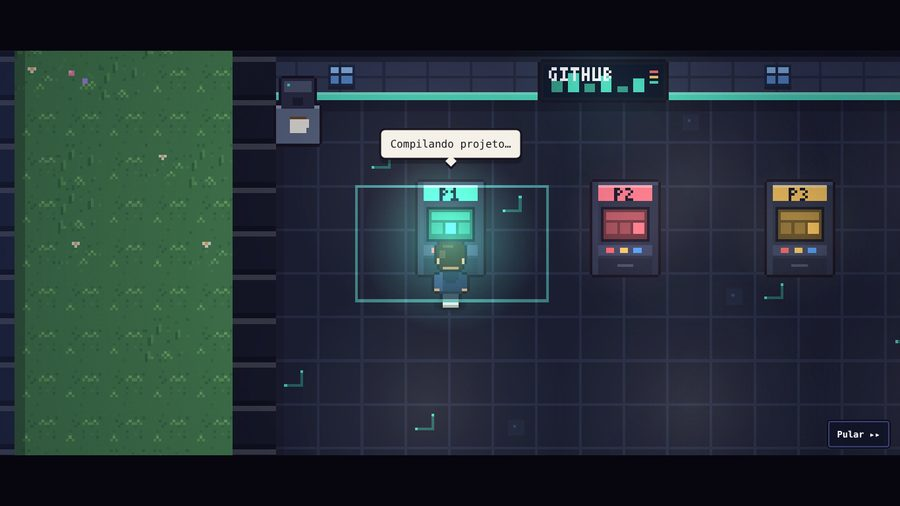
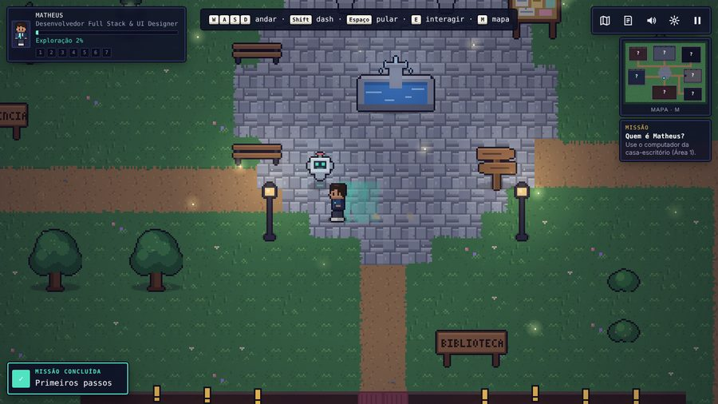
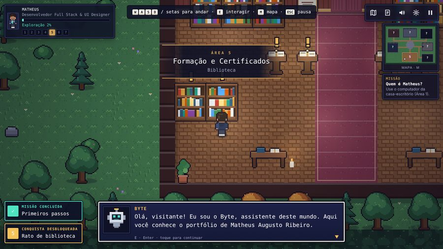
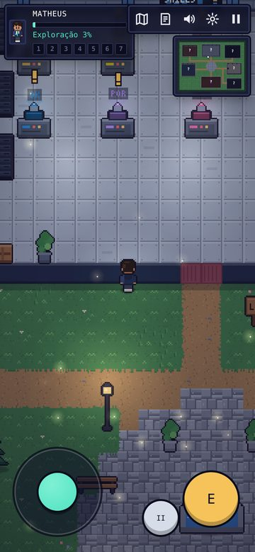

<div align="center">


# Matheus Augusto Ribeiro · Developer Portfolio

**Desenvolvedor Full Stack & UI Designer** · Cajamar, SP

Um portfólio profissional em forma de **jogo 2D de exploração em pixel art**.
Você controla o personagem, anda por 7 áreas e descobre minha trajetória,
habilidades, projetos e contatos interagindo com o mundo.

<!-- =====================================================================
     🔗 COLOQUE AQUI A URL DO SEU SITE NO RENDER
     Troque as duas ocorrências de https://SEU-APP.onrender.com abaixo.
     ===================================================================== -->

### 🎮 [**Jogar agora → https://SEU-APP.onrender.com**](https://SEU-APP.onrender.com)

[📄 Portfólio tradicional (sem jogo)](https://SEU-APP.onrender.com/#portfolio) ·
[💼 GitHub](https://github.com/matheusaribeirodev) ·
[✉️ E-mail](mailto:matheus.a.ribeiroo@gmail.com) ·
[💬 WhatsApp](https://wa.me/5511972181449) ·
[📸 Instagram](https://instagram.com/ribeiir0x)


</div>

---

## 📑 Sumário

- [Sobre o projeto](#-sobre-o-projeto)
- [Capturas de tela](#-capturas-de-tela)
- [Como jogar](#-como-jogar)
- [O mapa: 7 áreas](#-o-mapa-7-áreas)
- [Game feel e cutscenes](#-game-feel-e-cutscenes)
- [Recursos](#-recursos)
- [Acessibilidade](#-acessibilidade)
- [Rodando localmente](#-rodando-localmente)
- [Publicando no Render](#-publicando-no-render)
- [Como editar o conteúdo](#-como-editar-o-conteúdo)
- [Estrutura do projeto](#-estrutura-do-projeto)
- [Arquitetura](#-arquitetura)
- [Ajuste fino (tuning)](#-ajuste-fino-tuning)
- [Checklist antes de publicar](#-checklist-antes-de-publicar)
- [Contato](#-contato)

---

## 💡 Sobre o projeto

Quis um portfólio que ninguém esquecesse, sem abrir mão do essencial: um
recrutador que tem só 30 segundos precisa achar tudo rápido. Por isso, o
projeto tem **duas portas de entrada**:

| 🎮 Versão em jogo | 📄 Versão tradicional |
|---|---|
| Mundo 2D explorável, com personagem, NPC guia, missões, conquistas e cutscenes | Página organizada, com as mesmas informações, para ler em segundos |
| Menu **INICIAR JOGO** | Menu **PORTFÓLIO TRADICIONAL** ou o link `/#portfolio` |

Tudo foi feito com **HTML5, CSS3 e JavaScript puro, renderizado em Canvas 2D**.
Não há frameworks, dependências nem etapa de build. Todos os gráficos em pixel
art e todos os sons são **gerados por código**, então o projeto inteiro pesa
poucas centenas de KB.

---

## 📸 Capturas de tela

| Cutscene de abertura | Laboratório de habilidades |
|---|---|
|  |  |
| **Cutscene de interação** | **Dash com rastro** |
|  |  |
| **Biblioteca (formação e cursos)** | **Celular** |
|  |  |

---

## 🕹️ Como jogar

| Ação | Teclado | Celular / tablet |
|---|---|---|
| Andar | `W` `A` `S` `D` ou setas | Joystick virtual |
| Dash | `Shift` | Botão **»** |
| Pular | `Espaço` | Botão **⤒** |
| Interagir / avançar diálogo | `E` ou `Enter` | Botão **E** ou tocar na caixa |
| Mapa, viagem rápida e índice de conteúdo | `M` | Ícone de mapa / minimapa |
| Missões e conquistas | `Q` | Ícone de lista |
| Pausa / fechar janelas | `ESC` | Botão **II** |
| Pular cutscene | `ESC`, `E`, `Enter` ou `Espaço` | Botão **Pular ▸▸** |

> 💡 Objetos com um **!** amarelo ainda não foram explorados. O **Byte**, robô
> da praça central, dá dicas da próxima área.

---

## 🗺️ O mapa: 7 áreas

Uma praça central com fonte, postes e o guia Byte, cercada por:

| # | Área | Cenário | O que tem lá |
|---|---|---|---|
| 1 | **Sobre Mim** | Casa-escritório | Computador com a apresentação, quadro de perfil, mural de objetivos, estante da trajetória e impressora com o currículo |
| 2 | **Habilidades** | Laboratório tecnológico | Uma estação holográfica por tecnologia, mais o painel com as 4 áreas de atuação |
| 3 | **Projetos** | Centro de desenvolvimento | Um terminal por projeto, mais o painel com a lista do GitHub, carregada automaticamente |
| 4 | **Experiência** | Escritório corporativo | Experiências como "missões" numa linha do tempo |
| 5 | **Formação e Certificados** | Biblioteca | Púlpitos com a formação, globo com os idiomas e uma estante dourada por curso |
| 6 | **Depoimentos** | Galeria de exposição | Um quadro em cavalete por depoimento |
| 7 | **Contato** | Central de comunicação | Terminais de WhatsApp, e-mail, GitHub, Instagram e currículo, mais um rádio com formulário |

---

## ✨ Game feel e cutscenes

**Movimentação**
- **Inércia:** acelera, freia deslizando e derrapa ao inverter a direção.
- **Squash & stretch:** deformação com mola amortecida ao largar, parar, virar,
  dar dash, pular, aterrissar e bater na parede.
- **Partículas:** poeira nos passos, na largada, na freada, na derrapagem e no
  dash (com rastro de fantasmas), e anel de poeira na aterrissagem.
- **Câmera viva:** olha à frente do movimento, treme de leve nos impactos e dá
  zoom nas cutscenes.
- **Idle com personalidade:** respira, pisca, olha para os lados (5 s), se
  espreguiça (14 s) e cochila com "Zzz" (22 s).

**Cutscenes** (todas podem ser puladas e desligadas em Configurações)
- **Abertura:** a câmera desliza pelo mapa, um feixe de luz traz o personagem e
  o Byte dá as boas-vindas. Quem volta ao jogo vê uma versão curta.
- **Áreas:** na primeira visita, a câmera foca o objeto principal da área e um
  balão apresenta o lugar (cerca de 2 s).
- **Interações:** na primeira vez num projeto ou painel importante, há um zoom
  rápido com destaque e balão antes de o conteúdo abrir.

---

## 🧩 Recursos

- 🧭 **HUD:** nome, barra de exploração (%), áreas visitadas, minimapa, missão
  atual e botões de mapa, missões, áudio, configurações e pausa.
- 💬 **Diálogos estilo RPG**, com retrato e efeito de digitação.
- 🏆 **9 missões e 11 conquistas**, com notificações.
- 🗺️ **Mapa com viagem rápida** e índice de todo o conteúdo.
- 💾 **Progresso salvo** no navegador (`localStorage`).
- 🔊 **Trilha chiptune e efeitos** gerados com Web Audio, com volume e opções
  de ligar/desligar.
- 🐙 **"Mais no GitHub":** a lista de repositórios é carregada da API pública,
  então um repositório novo aparece sozinho.
- ✉️ **Formulário de contato:** usa Formspree se configurado; senão, abre o app
  de e-mail com a mensagem pronta.
- 🌗 **Tema claro/escuro** na versão tradicional.
- 📄 **Currículo em PDF** para download em vários pontos.

---

## ♿ Acessibilidade

- **Ninguém precisa jogar** para ver o conteúdo: há a versão tradicional
  (`/#portfolio`) e o índice do mapa (`M`), que abre qualquer conteúdo direto.
- Link "pular para o portfólio em texto" no topo da página.
- Navegação completa por teclado, com o foco preso dentro das janelas abertas.
- Respeita o **`prefers-reduced-motion`** do sistema e tem a opção "Reduzir
  movimento", que desliga cutscenes, deformação, partículas e efeitos.
- HTML semântico na versão tradicional, `aria-live` nos diálogos e
  notificações, e textos alternativos nas imagens.
- Conteúdo básico em `<noscript>` para navegadores sem JavaScript.

---

## 💻 Rodando localmente

Não precisa instalar nada.

**Opção 1:** extraia a pasta e dê **duplo clique no `index.html`**.

**Opção 2 (recomendada):** use um servidor local, que se comporta como em
produção:

```bash
cd portfolio-game
python -m http.server 8080
# ou
npx serve .
```

Depois acesse **http://localhost:8080**.

> ⚠️ Não abra o `index.html` de dentro do `.zip` sem extrair, porque o
> navegador não encontra as pastas `css/` e `js/`.

---

## 🚀 Publicando no Render

1. Envie a pasta para um repositório no GitHub (por exemplo, `quem-e-matheus`).
2. No [Render](https://render.com): **New → Static Site** → conecte o repositório.
3. Configure:

   | Campo | Valor |
   |---|---|
   | Build Command | *(deixe vazio)* |
   | Publish Directory | `.` |

4. Clique em **Create Static Site**. A cada `git push` o site é atualizado
   sozinho.
5. Coloque a URL gerada:
   - no topo deste README (procure `SEU-APP.onrender.com`);
   - em `js/portfolio-data.js` → `meta.siteUrl`;
   - no `index.html` → `<meta property="og:url">`.

> Também funciona em **GitHub Pages**, **Netlify** ou **Vercel**: é só um site
> estático, sem build.

---

## ✏️ Como editar o conteúdo

**Todo o conteúdo fica num único arquivo: [`js/portfolio-data.js`](js/portfolio-data.js).**
O jogo e a versão tradicional são gerados a partir dele.

```js
certificates: [
  { id: "compliance", name: "Compliance: Prevenir, Identificar e Corrigir", issuer: "SENAI (EAD)" },
  // adicione um novo curso aqui 👇
],
```

Ao adicionar um item em `skills`, `projects`, `experience`, `education`,
`certificates` ou `testimonials`, **o mapa cria sozinho** a estação, o
terminal, a mesa, a estante ou o quadro correspondente.

| Quero mudar… | Onde |
|---|---|
| Textos do Sobre, números, frase de destaque | `profile` |
| Currículo em PDF | Substitua `assets/Curriculo_Matheus_Augusto_Ribeiro.pdf` (mesmo nome) |
| Tecnologias e áreas de atuação | `skills` e `skillAreas` |
| Projetos em destaque | `projects` |
| Formação, idiomas e cursos | `education`, `languages`, `certificates` |
| WhatsApp, e-mail, redes e formulário | `contact` |
| LinkedIn (o terminal aparece no mapa quando preenchido) | `contact.linkedin` |
| Cores do avatar | `profile.avatar` |
| Título, descrição e imagem de compartilhamento | `meta` |

> Qualquer valor que comece com `⚠` (ou que seja `null`) é tratado como
> **pendente**: aparece destacado e nunca vira um link quebrado.

---

## 📁 Estrutura do projeto

```
portfolio-game/
├── index.html              # estrutura, metadados, menu, HUD, janelas
├── css/
│   ├── style.css           # base, componentes e portfólio tradicional
│   └── game.css            # menu, HUD, diálogos, modais, cutscenes, toque
├── js/
│   ├── portfolio-data.js   # ← TODO o conteúdo do portfólio
│   ├── sprites.js          # pixel art procedural (tiles, personagem, objetos)
│   ├── map.js              # geração do mundo e posicionamento das 7 áreas
│   ├── player.js           # movimento com game feel, squash & stretch, dash, pulo, idle
│   ├── game.js             # loop, câmera, luz, partículas, efeitos e renderização
│   ├── interactions.js     # o que cada objeto faz ao apertar E
│   ├── cutscene.js         # diretor de cutscenes: abertura, áreas e foco em objetos
│   ├── ui.js               # HUD, diálogos, janelas, mapa, portfólio tradicional
│   ├── state.js            # progresso, missões, conquistas e configurações (localStorage)
│   ├── audio.js            # efeitos e trilha chiptune (Web Audio API)
│   ├── input.js            # teclado e joystick virtual
│   └── main.js             # inicialização, menu animado e atalhos
├── assets/
│   ├── Curriculo_Matheus_Augusto_Ribeiro.pdf
│   └── icons/favicon.svg
├── img/                    # foto.webp, etiquetaflow.webp, forninho.webp
├── docs/screenshots/       # imagens deste README
└── README.md
```

---

## 🏗️ Arquitetura

```
portfolio-data.js ──► map.js (monta o mundo) ──► game.js (loop 60 fps)
        │                                           │   ├─ player.js (física + animação)
        │                                           │   ├─ luz, partículas, câmera
        ▼                                           │   └─ cutscene.js (roteiros)
      ui.js ◄──── interactions.js ◄──── tecla E ────┘
   (janelas, HUD,
    versão tradicional)        state.js ⇄ localStorage
```

- **Renderização pixel-perfect:** o jogo é desenhado num buffer de baixa
  resolução e ampliado em escala inteira, então os pixels ficam nítidos em
  qualquer tela.
- **Profundidade:** objetos e personagem são ordenados pela posição Y, para
  passar na frente ou atrás corretamente.
- **Iluminação:** uma camada de escuridão ambiente é "recortada" pelas luzes
  (postes, telas, velas), com brilho colorido aditivo por cima.
- **Colisão:** por tiles, com hitbox nos pés e deslize automático em quinas.
- **Cutscenes:** roteiros `async/await` com câmera, zoom, balões e efeitos.
  Qualquer passo pode ser pulado e o estado final é sempre garantido.

---

## 🎛️ Ajuste fino (tuning)

No topo de [`js/player.js`](js/player.js):

```js
const TUNING = {
  speed: 92,        // velocidade andando (px/s)
  accel: 11,        // resposta ao acelerar
  decel: 7,         // frenagem (menor = desliza mais)
  turn: 20,         // resposta ao inverter direção
  dashSpeed: 255, dashTime: 0.15, dashCooldown: 0.5,
  jumpVel: 150, gravity: 640,
  springK: 340, springD: 15, // "elasticidade" do squash & stretch
};
```

As falas das cutscenes de cada área ficam em `LINES`, em
[`js/cutscene.js`](js/cutscene.js).

---

## ✅ Checklist antes de publicar

- [ ] Copiar `img/foto.webp`, `img/etiquetaflow.webp` e `img/forninho.webp` do site original
- [ ] Colocar `og-image.jpg` (1200×630) na raiz, para a prévia no WhatsApp e no LinkedIn
- [ ] Trocar `SEU-APP.onrender.com` neste README, em `meta.siteUrl` e no `og:url`
- [ ] (Opcional) Criar o formulário no [Formspree](https://formspree.io) e colar o link em `contact.form.formEndpoint`
- [ ] (Opcional) Preencher `contact.linkedin`

---

## 📬 Contato

**Matheus Augusto Ribeiro** · Desenvolvedor Full Stack & UI Designer · Cajamar, SP

[✉️ matheus.a.ribeiroo@gmail.com](mailto:matheus.a.ribeiroo@gmail.com) ·
[💬 (11) 97218-1449](https://wa.me/5511972181449) ·
[💼 GitHub](https://github.com/matheusaribeirodev) ·
[📸 @ribeiir0x](https://instagram.com/ribeiir0x)

<sub>Feito com código e café no Brasil ☕</sub>
